# Notes Storage

[](https://developer.android.com)
[](https://developer.android.com/jetpack/compose)
[](https://developer.android.com/about/dashboards)
[](https://developer.android.com)

A modern, offline-first Android note-taking application demonstrating dual-storage architecture, data synchronization, and complete CRUD workflows using Jetpack Compose and Material 3.

---

## 1. Project Name
**Notes Storage** (`com.example.notesstorage`)

---

## 2. Project Description
**Notes Storage** is an Android application developed to demonstrate persistent data management on mobile devices. The app supports two independent persistent storage engines:
1. **Primary Engine:** SQLite relational database managed via Android Jetpack Room.
2. **Secondary Engine:** Internal file storage using structured JSON (`notes.json`).

The application allows users to create, view, modify, and delete notes within either storage engine, switch between engines dynamically via an intuitive UI selector, and perform a one-way synchronization to replicate SQLite notes into JSON storage. The project is designed following the MVVM pattern with a dedicated repository layer, featuring an entirely declarative UI built with Jetpack Compose.

---

## 3. Features
- **Dual Persistent Storage:** Toggle seamlessly between SQLite (Room) and JSON internal file storage.
- **Full CRUD Capabilities:** Create, Read, Update, and Delete notes independently in both storage types.
- **Data Synchronization:** One-way data synchronization from SQLite to JSON with conflict-free atomic file replacement.
- **Strict Data Isolation:** Clear separation between storage states preventing cross-contamination during UI updates.
- **Robust Input Validation:** Form-level validation preventing empty or whitespace-only note titles and content.
- **Resilient File Handling:** Atomic write strategy using temporary (`.tmp`) and backup (`.bak`) files with filesystem synchronization (`fd.sync()`) to guarantee data integrity across unexpected crashes.
- **Modern Jetpack Compose UI:** Material Design 3 interface supporting dynamic color, dark and light themes, and fluid navigation.
- **Bilingual Localization:** Complete string localization for English (default) and Russian.

---

## 4. Technologies Used
- **Android Target:** `compileSdk = 37`, `targetSdk = 37`, `minSdk = 24` (Android 7.0 Nougat and newer)
- **Build Tools:** Android Studio build 261.26222.65 with bundled JetBrains Runtime (JDK 25.0.3; Java 17 source/target compatibility in `app/build.gradle.kts`), Gradle 9.6.0 (wrapper), and Android Gradle Plugin (AGP) 9.4.1
- **Kotlin & Compiler Plugins:** Built-in Kotlin support of AGP 9.4.1, Jetpack Compose compiler plugin `2.2.10`, and KSP `2.2.10-2.0.2`
- **UI Framework:** Jetpack Compose (BOM `2024.10.01`, Material 3, Material Icons Extended)
- **Architecture Components:**
  - `AndroidViewModel` and `viewModelScope`
  - Jetpack Compose Navigation (`androidx.navigation:navigation-compose:2.8.3`)
  - Kotlin Coroutines & Asynchronous StateFlow/SharedFlow (`1.9.0`)
- **Data Persistence:**
  - Android Jetpack Room (`2.7.2`) with KSP code generation
  - Android Internal File System (`java.io.File`, `FileOutputStream`, `org.json`)
- **Unit Testing:** JUnit 4 (`4.13.2`), `kotlinx-coroutines-test:1.9.0`, `org.json:json:20240303`

---

## 5. Application Architecture
The project implements the **Model-View-ViewModel (MVVM)** pattern with a dedicated repository layer:

```text
┌────────────────────────────────────────────────────────┐
│                   UI Layer (Compose)                   │
│  - NotesListScreen    - NoteDetailScreen               │
│  - NoteEditScreen     - NotesAppNavigation             │
└───────────────────────────▲────────────────────────────┘
                            │ UI State & Events
┌───────────────────────────┴────────────────────────────┐
│                    ViewModel Layer                     │
│  - NotesViewModel (AndroidViewModel)                   │
│    * Manages NotesUiState (currentStorage, notes, etc.)│
│    * Dispatches UiEvent (Snackbars, Navigation)        │
│    * Isolates Flow subscriptions per storage type      │
└───────────────────────────▲────────────────────────────┘
                            │ Domain Calls
┌───────────────────────────┴────────────────────────────┐
│                   Repository Layer                     │
│  - NotesRepository / NotesRepositoryImpl               │
│    * Coordinates SQLite and JSON operations            │
│    * In-memory cache & StateFlow for JSON updates      │
│    * Executes Dispatchers.IO background operations     │
└───────────────────────────▲────────────────────────────┘
                            │
              ┌─────────────┴─────────────┐
              ▼                           ▼
┌───────────────────────────┐ ┌──────────────────────────┐
│   Room Database Layer     │ │    JSON File Storage     │
│ - AppDatabase (notes.db)  │ │ - JsonNotesStorage       │
│ - NoteDao (Room DAO)      │ │ - notes.json (Internal)  │
│ - NoteEntity              │ │ - Atomic write via .bak  │
└───────────────────────────┘ └──────────────────────────┘
```

- **UI Layer (`com.example.notesstorage.ui`):** Jetpack Compose composables collecting state via `collectAsState()` and sending user intentions to the ViewModel.
- **ViewModel Layer (`com.example.notesstorage.viewmodel`):** Manages UI state (`NotesUiState`), handles storage switching, cancels out-of-date Flow collection jobs to prevent data overlap, and performs form validation before dispatching mutations.
- **Repository Layer (`com.example.notesstorage.repository`):** Abstracts data sources behind the `NotesRepository` interface, translating entity models to domain models (`Note`) and executing disk I/O on `Dispatchers.IO`.
- **Data Sources:** 
  - `AppDatabase` & `NoteDao`: Reactive Room implementation exposing `Flow<List<NoteEntity>>`.
  - `JsonNotesStorage`: Thread-safe, mutex-protected file manager handling serialization and deserialization.

---

## 6. Data Storage
The app stores notes with the following core properties:
- `id` (String / UUID): Unique identifier.
- `title` (String): Non-empty note title.
- `content` (String): Non-empty note body.
- `createdAt` (Long): Timestamp in milliseconds.
- `updatedAt` (Long): Timestamp of last modification in milliseconds.

Both storages operate completely independently during standard operations. Adding, modifying, or deleting a note in SQLite does not affect JSON storage until an explicit synchronization is triggered.

---

## 7. SQLite Database
- **Implementation:** Android Jetpack Room 2.7.2.
- **Database Name:** `notes.db`
- **Location on Device:** `/data/data/com.example.notesstorage/databases/notes.db`
- **Entity:** `NoteEntity` mapping to table `notes` with `id` as `@PrimaryKey`.
- **DAO Operations:**
  - `getAllNotesFlow()`: Reactive query ordered by `updatedAt DESC`.
  - `insertNote()`, `updateNote()`, `deleteById()`: Asynchronous transactional operations.
  - `replaceAll()`: `@Transaction` method used during complete atomic batch replacements.

---

## 8. JSON File Storage
- **Implementation:** Custom resilient storage class `JsonNotesStorage`.
- **File Name:** `notes.json`
- **Location on Device:** `/data/data/com.example.notesstorage/files/notes.json`
- **Format Structure (illustrative example):**
```json
[
  {
    "id": "b1f46060-64eb-410a-b362-7fa3452c92e7",
    "title": "Test Note Edited",
    "content": "This is a test note. The content was changed.",
    "createdAt": 1730834311000,
    "updatedAt": 1730834395000
  }
]
```
- **Durability and Crash Recovery Strategy:**
  1. Serialized JSON is written to a temporary file (`notes.json.tmp`).
  2. The file descriptor is explicitly flushed and synced to disk via `fos.fd.sync()`.
  3. The current `notes.json` is renamed to a backup file (`notes.json.bak`).
  4. The temporary file is renamed to `notes.json`.
  5. The backup file is removed upon successful write completion.
  6. **Auto-Recovery:** If the app or device terminates mid-write, `readNotesInternal()` detects `notes.json.bak` on the next launch and automatically restores it.

---

## 9. CRUD Operations
The application supports complete CRUD functionality in both storage modes:

| Operation | SQLite Mechanism | JSON Mechanism | Evidence Screenshot |
|:---|:---|:---|:---|
| **Create** | `noteDao.insertNote(entity)` | Prepend note to array and save | 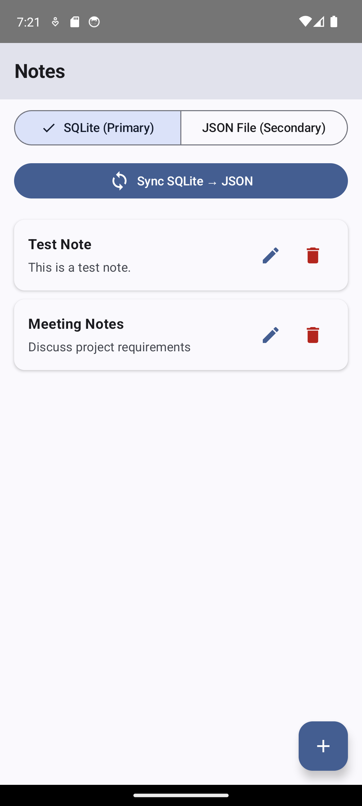 |
| **Read** | `noteDao.getNoteById(id)` & `getAllNotesFlow()` | Parse `notes.json` to domain list | 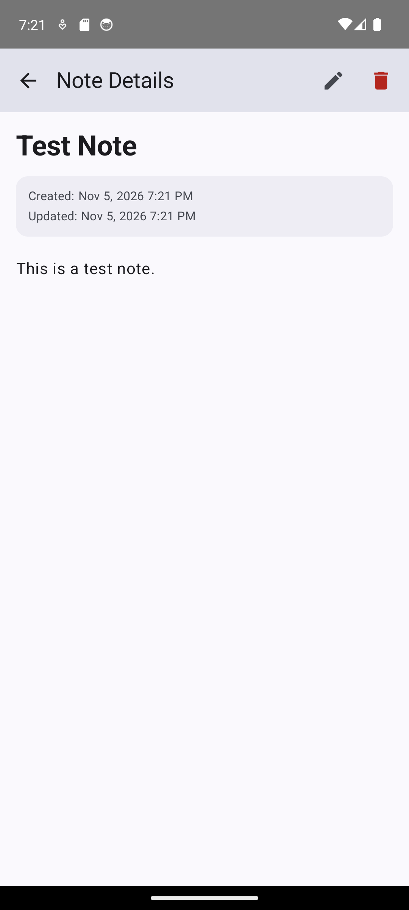 |
| **Update** | `noteDao.updateNote(entity)` | Locate note by ID, replace, and save | 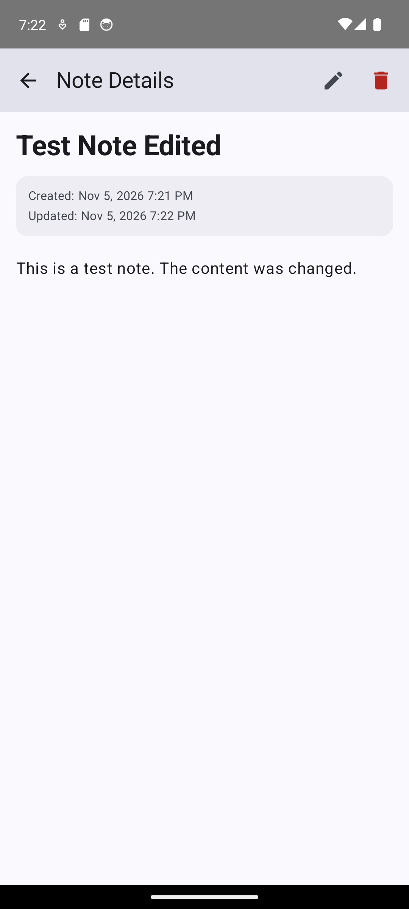 |
| **Delete** | `noteDao.deleteById(id)` | Remove note by ID and save | 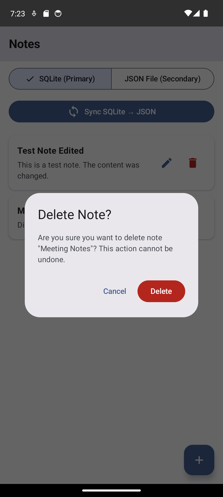 |

---

## 10. Data Synchronization
- **Type:** One-way synchronization (**SQLite &rarr; JSON**).
- **Behavior:**
  - Reads all existing notes from the SQLite database (`NoteDao.getAllNotes()`).
  - Completely overwrites `notes.json` using the atomic write mechanism.
  - Retains original UUID identifiers and creation timestamps.
  - Removes notes from JSON that were previously deleted in SQLite.
- **Feedback:** Shows a progress indicator on the sync button, followed by an informative Material 3 Snackbar displaying the total number of exported notes:
  - *English:* `"Synced successfully: X notes exported to JSON"`
  - *Russian:* `"Синхронизация завершена: X заметок сохранено в JSON"`

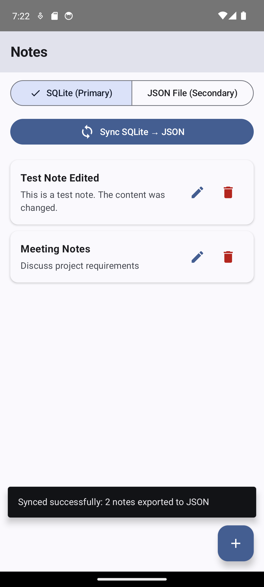
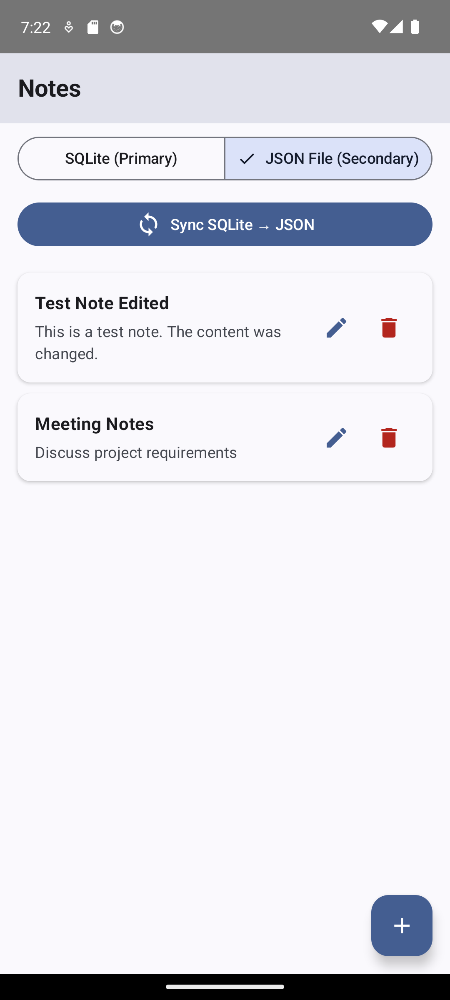

---

## 11. Input Validation
To maintain clean persistent states, input validation runs before any database or file transaction. The rules live in `NoteValidator.validate()` (`model/NoteValidator.kt`), which `NotesViewModel.saveNote()` calls:
- **Title Validation:** Must not be empty or consist solely of whitespace (`rawTitle.trim().isEmpty()`).
- **Content Validation:** Must not be empty or consist solely of whitespace (`rawContent.trim().isEmpty()`).
- **User Feedback:** In-place error messages are rendered below each corresponding text field in `NoteEditScreen`:
  - `"Title cannot be empty"` / `"Заголовок не может быть пустым"`
  - `"Content cannot be empty"` / `"Содержимое не может быть пустым"`

| Validation Scenario | In-app Result |
|:---|:---|
| Both fields empty | 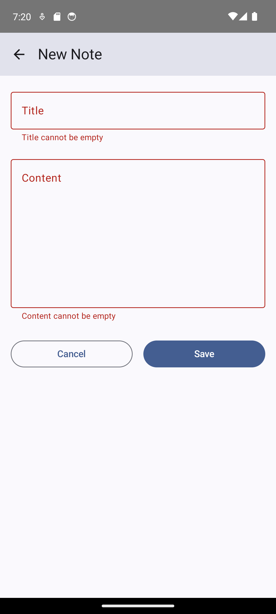 |
| Whitespace-only title | 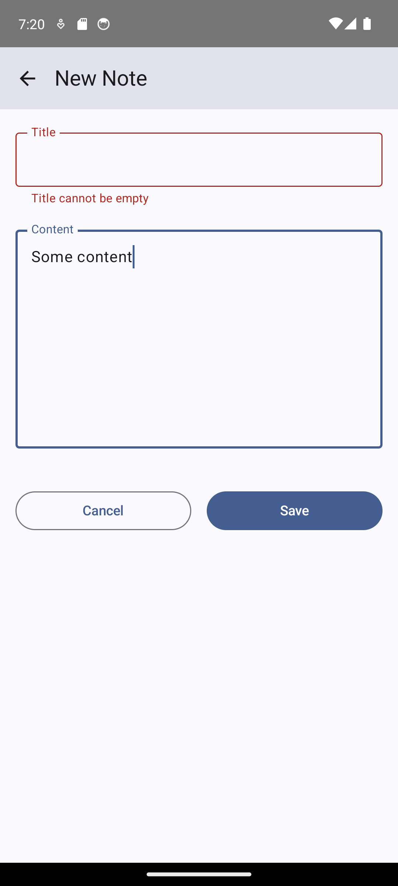 |
| Whitespace-only content | 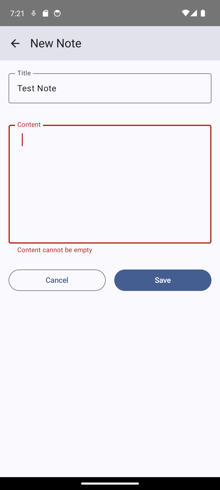 |

---

## 12. Localization
All user-facing strings, accessibility content descriptions, validation messages, and dialog texts are separated into Android resource files:
- **Default (English):** `android-app/app/src/main/res/values/strings.xml`
- **Russian:** `android-app/app/src/main/res/values-ru/strings.xml`

Dates and timestamps in `NoteDetailScreen` dynamically adapt to system locale conventions using `DateFormat.getDateTimeInstance(DateFormat.MEDIUM, DateFormat.SHORT)`.

| English Interface | Russian Interface |
|:---|:---|
| 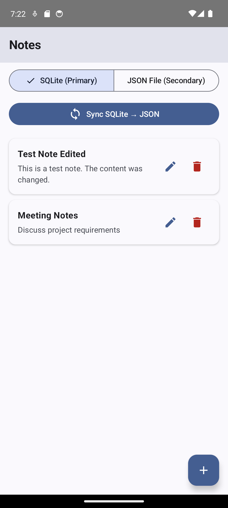 | 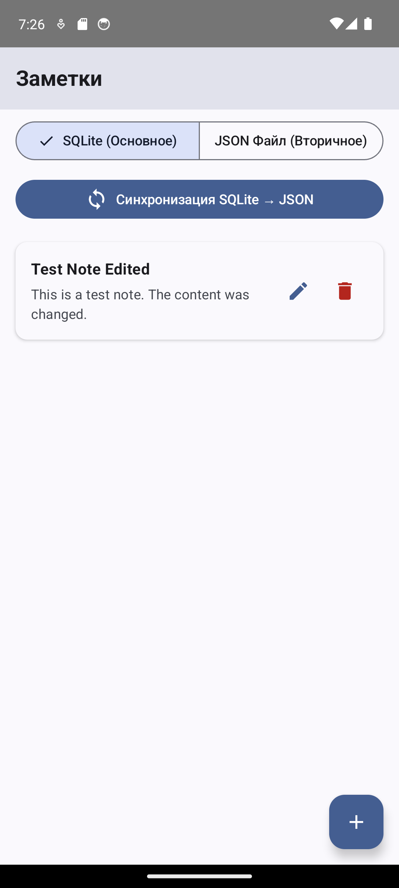 |
|  | 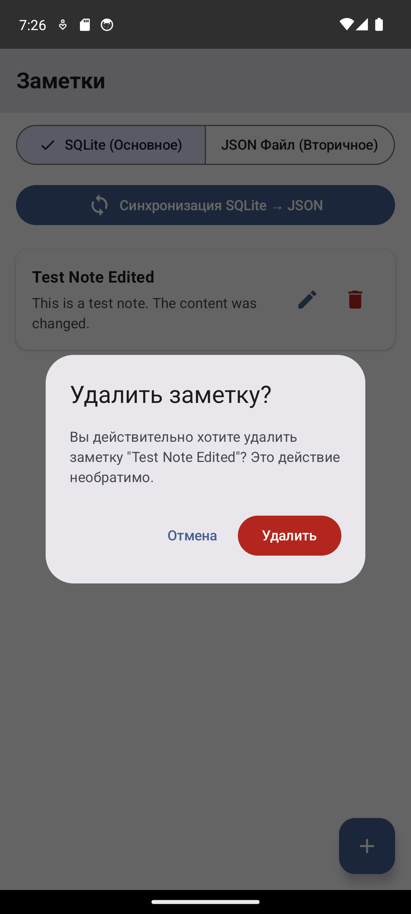 |

---

## 13. Project Structure
```
lab_4/
├── android-app/
│   ├── app/
│   │   ├── build.gradle.kts           # App module build definition and dependencies
│   │   ├── proguard-rules.pro         # Proguard rules
│   │   └── src/
│   │       ├── main/
│   │       │   ├── AndroidManifest.xml
│   │       │   ├── java/com/example/notesstorage/
│   │       │   │   ├── MainActivity.kt               # Navigation host & entry point
│   │       │   │   ├── database/
│   │       │   │   │   ├── AppDatabase.kt            # Room database definition
│   │       │   │   │   ├── NoteDao.kt                # Data access object
│   │       │   │   │   └── NoteEntity.kt             # Room table entity
│   │       │   │   ├── model/
│   │       │   │   │   ├── Note.kt                   # Domain model & StorageType enum
│   │       │   │   │   └── NoteValidator.kt         # Pure title/content validation
│   │       │   │   ├── repository/
│   │       │   │   │   └── NotesRepository.kt        # Repository implementation
│   │       │   │   ├── storage/
│   │       │   │   │   └── JsonNotesStorage.kt       # Resilient JSON file engine
│   │       │   │   ├── ui/
│   │       │   │   │   ├── screens/
│   │       │   │   │   │   ├── NotesListScreen.kt    # Main list, selector, sync
│   │       │   │   │   │   ├── NoteDetailScreen.kt   # Detailed note preview & delete
│   │       │   │   │   └── NoteEditScreen.kt     # Note creation & editing form
│   │       │   │   │   └── theme/
│   │       │   │   │       └── Theme.kt              # Material 3 dynamic color theme
│   │       │   │   └── viewmodel/
│   │       │   │       └── NotesViewModel.kt         # StateFlow & coroutine coordinator
│   │       │   └── res/
│   │       │       ├── values/strings.xml            # Default (English) strings
│   │       │       └── values-ru/strings.xml         # Russian localized strings
│   │       └── test/java/com/example/notesstorage/
│   │           ├── InMemoryMockNoteDao.kt            # Unit test DAO mock
│   │           └── NotesStorageUnitTest.kt           # 15 JVM unit tests (real JSON storage, sync and validation; SQLite via DAO mock)
│   ├── build.gradle.kts                              # Root build script
│   ├── gradle.properties                             # Gradle build configuration
│   ├── settings.gradle.kts                           # Module and plugin settings
│   └── gradle/libs.versions.toml                     # Version catalog
└── docs/
    ├── CODE_REVIEW.md                                # Detailed code review findings
    ├── WORK_LOG.md                                   # Chronological execution log
    ├── SESSION_SUMMARY.md                            # Final report for submission (Moodle)
    ├── evidence/
    │   ├── TEST_RESULTS.md                           # Verification test report
    │   └── screenshots/                              # Device capture evidence
    └── prompts/                                      # Generation & review prompt archives
```

---

## 14. Installation Instructions

### Prerequisites
- **Android Studio:** a recent build (the project was built with 261.26222.65). Its bundled JetBrains Runtime (JDK 25) is what Gradle uses when the project is opened in the IDE.
- **JDK for command-line builds:** Gradle starts its daemon with JDK 25. It uses a JDK 25 found on the computer, or downloads one on the first build (internet required). The most reliable option is to set `JAVA_HOME` to Android Studio's JBR, for example `C:\Program Files\Android\Android Studio\jbr`. Source and target compatibility is Java 17 (`app/build.gradle.kts`).
- **Android SDK:** platforms 35 to 37 (`compileSdk 37`, `targetSdk 37`, `minSdk 24`). Android Studio writes the SDK path to `android-app/local.properties`, which is not stored in the repository. Without Android Studio, set `ANDROID_HOME` or create `android-app/local.properties` containing `sdk.dir=<path to the SDK>`.

### Clone and Open
1. Clone the repository:
   ```bash
   git clone https://github.com/wesneyk/MADT_LAB4.git
   cd MADT_LAB4
   ```
2. In Android Studio, select **File &gt; Open...** and choose the `android-app` folder.
3. Allow Gradle to synchronize dependencies, then press **Run** with an emulator or a device (minSdk 24; tested on Android 14, API 34).

---

## 15. How to Run the Application

### Command Line
Run these from the repository root, the folder that contains `android-app`.

#### On Windows (PowerShell or cmd):
```cmd
cd android-app
gradlew.bat clean assembleDebug
gradlew.bat testDebugUnitTest
gradlew.bat lintDebug
gradlew.bat installDebug
adb shell am start -n com.example.notesstorage/.MainActivity
```
`installDebug` needs a running emulator or a connected device (`adb devices` must list it).

#### On Linux / macOS:
```bash
cd android-app
./gradlew clean assembleDebug
./gradlew testDebugUnitTest
./gradlew lintDebug
./gradlew installDebug
adb shell am start -n com.example.notesstorage/.MainActivity
```

The debug APK is written to `android-app/app/build/outputs/apk/debug/app-debug.apk`. It is not stored in the repository.
---

## 16. How to Use the Application

### 1. Choosing the Storage Engine
At the top of the main screen, use the segmented buttons to select your active storage:
- **SQLite (Primary):** Data is read from and written to the SQLite database.
- **JSON File (Secondary):** Data is read from and written to `notes.json`.

### 2. Creating a Note
1. Tap the floating **+** button in the lower-right corner.
2. Enter a note title and body content.
3. Tap **Save**. If any field contains only whitespace or is empty, validation indicators will prevent saving.
4. On success, the app returns to the list and displays a confirmation snackbar.

### 3. Viewing and Editing
1. Tap on any note card to open its detail view, showing the title, content, creation timestamp, and last updated timestamp.
2. Tap the **Edit (Pencil)** icon to open the edit screen.
3. Modify the title or content and tap **Save**. The detail screen and main list reflect updates immediately.

### 4. Deleting a Note
1. Tap the **Delete (Trash)** icon from either the note card on the main screen or inside the detail screen.
2. A confirmation dialog will appear. Confirm by tapping **Delete** to permanently remove the note.

### 5. Synchronizing SQLite to JSON
1. While on the main screen, tap the **Sync SQLite &rarr; JSON** button.
2. The app copies all SQLite notes into `notes.json`, replacing any conflicting or deleted entries.
3. Switch to the **JSON File** tab to inspect the synced data.

---

## 17. Testing
The project has 15 automated JVM unit tests and emulator-based functional checks. The unit tests run the real JSON storage, repository sync and validation classes in a temporary folder. The SQLite CRUD tests use a DAO mock, because Room needs an Android device. The project has no instrumented Android UI tests yet.

### Automated JVM Unit Tests (`NotesStorageUnitTest.kt`)
Run with `gradlew testDebugUnitTest` (Windows: `gradlew.bat testDebugUnitTest`). 15 tests, all pass:
- **JSON storage (real `JsonNotesStorage`, temporary folder):** `jsonStorage_createReadUpdateDelete`, `jsonStorage_updateAndDeleteOfMissingNoteReturnFalse`, `jsonStorage_keepsIdsAndTimestamps`, `jsonStorage_writeReplacesContentAndLeavesNoTempFiles`, `jsonStorage_recoversFromBackupIfMainFileIsMissing`.
- **One-way sync (real `NotesRepositoryImpl` and `JsonNotesStorage`):** `sync_copiesSqliteNotesToJsonWithSameIdsAndReportsCount`, `sync_removesJsonOnlyNotes`, `sync_twiceCreatesNoDuplicates`, `sync_removesNotesDeletedInSqlite`.
- **Storage separation and SQLite CRUD:** `storages_areIndependent`; `sqliteCrud_throughRepository_withDaoMock` (uses `InMemoryMockNoteDao`, not the Room engine).
- **Validation (real `NoteValidator`):** `validation_rejectsBlankTitle`, `validation_rejectsBlankContent`, `validation_treatsTabsAndNewlinesAsBlank`, `validation_acceptsNonEmptyValues`.
### Emulator Functional Verification
Functional behavior was driven on an Android Emulator running **Android 14 (API 34)** using `adb` inputs, `uiautomator` dumps, and inspections via `adb run-as`:
- **Build & Launch:** Clean build and successful startup with crash buffer empty.
- **Validation:** Confirmed UI blocking on blank inputs and whitespace-only submissions.
- **SQLite CRUD:** Confirmed complete create, read, update, and delete workflow.
- **JSON CRUD:** Confirmed complete create, read, update, and delete workflow with direct verification of `files/notes.json` via `adb run-as`.
- **Sync Integrity:** Verified single-run and repeated sync operations; verified that deleting a note in SQLite removes it from JSON upon synchronization.
- **Storage Isolation:** Confirmed that switching between SQLite and JSON preserves strict visual and data separation without leakage.
- **Process Termination:** Verified persistence of both storages across app force-stop (`am force-stop`) and relaunch.
- **Localization:** Verified full UI string adaptation when switching device locale to Russian (`ru-RU`).
- **Re-check after the final fixes (2026-11-05):** after a save the list shows "Note created successfully" or "Note updated successfully"; sync shows "Synced successfully: N notes exported to JSON"; delete shows "Note deleted successfully"; the crash buffer stayed empty. Details: [TEST_RESULTS.md](docs/evidence/TEST_RESULTS.md#re-check-after-the-final-fixes-2026-11-05).

*Note on Unrun Test:* A physical/emulator check of the atomic file writing fix specifically on Android 7.0/7.1 (API 24/25) was not run because no API 24/25 emulator image was installed. File operations were confirmed functional on API 34.

Detailed results and captured logs are documented in [TEST_RESULTS.md](docs/evidence/TEST_RESULTS.md).

---

## 18. Code Review Improvements
During the code review process (detailed in [CODE_REVIEW.md](docs/CODE_REVIEW.md)), two critical architecture issues were identified and resolved:

### 1. API 24/25 Atomic Write Compatibility (`JsonNotesStorage.kt`)
- **Issue:** The original implementation relied on `java.nio.file.Files.move` which causes a fatal `NoClassDefFoundError` on Android API 24 and 25 when `minSdk = 24`.
- **Solution:** Replaced with standard file system atomic operations: writing to a temporary file (`.tmp`), invoking `fos.fd.sync()`, backing up to `.bak`, and using `renameTo()`. Added auto-recovery logic to restore `.bak` files if a crash occurs during a write cycle.

### 2. Coroutine Flow Leak & Stale State Elimination (`NotesViewModel.kt`)
- **Issue:** Switching storages left the SQLite Room `Flow` collector running in the background, causing SQLite updates to overwrite the JSON UI state. In addition, the detail view displayed stale data after editing.
- **Solution:** Introduced a tracked `notesObservationJob: Job?` cancelled before launching any new flow collection, updated `selectedNote` directly in `saveNote()`, and cleared `selectedNote` when toggling storage modes.

### 3. Final fixes (same day, after the review)
- **Save confirmation:** one-shot UI events (snackbars) moved from a `MutableSharedFlow` to a buffered `Channel`. Before, the "Note created/updated" snackbar was lost, because the list screen was not collecting events when it reappeared after a save.
- **Validation:** the title and content check moved into `model/NoteValidator.kt`, a pure function with unit tests. Behaviour is unchanged.
- **Unit tests:** JSON storage, sync and storage separation are now tested with the real classes (15 tests in total).
- **Build configuration:** the machine-specific `org.gradle.java.home` path was removed from `gradle.properties`. `lintDebug` no longer fails on it.

---

## 19. Requirements Compliance

| Lab Requirement | Implementation Status | Evidence / Notes |
|:---|:---|:---|
| SQLite primary storage | **Compliant** | Room database `notes.db` with `NoteDao` interface. |
| Secondary JSON storage | **Compliant** | Internal storage file `notes.json` with atomic writes. |
| Full CRUD in both storages | **Compliant** | Create, Read, Update, Delete verified in both engines. |
| Switch between storages | **Compliant** | Segmented button selector in `NotesListScreen`. |
| One-way sync (SQLite &rarr; JSON) | **Compliant** | Sync button exports SQLite database into `notes.json`. |
| Form input validation | **Compliant** | Rejects empty and whitespace-only titles and bodies. |
| Bilingual localization | **Compliant** | English (`values`) and Russian (`values-ru`). |
| Modern Jetpack Compose UI | **Compliant** | Material 3 components, dynamic theming, Navigation Compose. |
| Architecture & Clean Code | **Compliant** | MVVM pattern with repository layer and coroutine confinement. |
